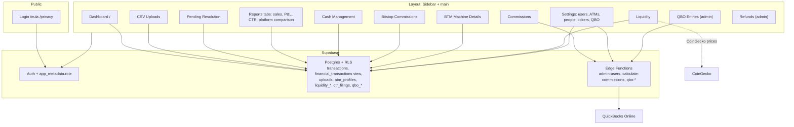

# Denet (BTM Analytics) — project notes

Internal dashboard for Denet's Bitcoin ATM (BTM) operation: ingest platform CSVs, track sales/P&L, cash, commissions, liquidity, CTR filings, and (admin) QuickBooks journal entries.

Repo: [speckryche/Denet](https://github.com/speckryche/Denet). These notes describe `main` at `5daf55c`.

## Stack

- **Frontend:** React 18, TypeScript, Vite 7, React Router 6
- **UI:** Tailwind CSS 3, shadcn/ui (New York / slate), Radix primitives, Lucide icons, Framer Motion
- **Data / auth:** Supabase (`@supabase/supabase-js`) — Postgres + Auth + RLS + Edge Functions
- **Exports:** `xlsx-js-style`, `@react-pdf/renderer`, Papa Parse, JSZip
- **Deploy:** Vercel SPA (`vercel.json` rewrites all routes to `index.html`). `package.json` pins `engines.node` to `24.x`.
- **Integrations:** Intuit QuickBooks Online (admin Edge Functions), CoinGecko (public price API, no key in the client)

The Vite/README scaffolding is still in the repo (`package.json` name is `starter`; root `README.md` is the stock Vite template). 39 `src/stories/*` files look leftover from the Tempo/shadcn starter and are unused by the app.

## How to run

Frontend env (names only — put them in a local `.env`, which is gitignored):

- `VITE_SUPABASE_URL`
- `VITE_SUPABASE_ANON_KEY`
- `VITE_BASE_PATH` (optional; production Vite `base`, defaults to `/`)

```bash
npm install
npm run dev          # Vite dev server
npm run build        # tsc, then vite build (see Known issues)
npm run preview
```

Other scripts: `types:supabase` (needs `SUPABASE_PROJECT_ID`), `qbo:harness`, `bitstop:harness`. Do not run harnesses or migrations against production data from a casual checkout.

Edge Functions (Supabase secrets, not Vite) also expect:

- `SUPABASE_URL`, `SUPABASE_SERVICE_ROLE_KEY` (usually provided by the platform)
- `QBO_ENV`, `QBO_CLIENT_ID`, `QBO_CLIENT_SECRET`, `QBO_REDIRECT_URI`

Harness-only env (not needed to run the app): `COINBASE_ZIP`, `BITSTOP_XLSX`, `BITSTOP_CSV`, `BITSTOP_MONTH`, `BITSTOP_RATE`.

## Structure

```
src/
  App.tsx, main.tsx          # router + AuthProvider
  contexts/                  # AuthContext, SidebarContext
  lib/                       # supabase client, P&L, CTR, ATM profiles, QBO helpers, status rules
  types/supabase.ts          # generated DB types
  components/
    layout/                  # Layout, Sidebar, PageHeader, UserMenu
    auth/, legal/            # login; public /eula and /privacy
    dashboard/, csv-uploads/, pending/, reports/, commissions/,
    cash-management/, bitstop/, btm-details/, liquidity/,
    qbo-entries/, refunds/, settings/
    ui/                      # shadcn primitives
  stories/                   # unused starter stories
supabase/
  migrations/                # schema, RLS, RPCs, views
  functions/                 # admin-users, calculate-commissions, qbo-*
  config.toml                # qbo-oauth-callback has verify_jwt = false (state-token auth)
scripts/                     # qbo/bitstop harnesses, P&L recon
```

Path alias: `@/` → `src/`.

## Routing and chrome

`ProtectedRoute` in `src/App.tsx` gates every app route: unauthenticated users see `Login`; authenticated users get `Layout` (fixed sidebar + left-offset main). Public exceptions: `/eula`, `/privacy`.

Sidebar items (`src/components/layout/Sidebar.tsx`):

| Nav label | Path | Notes |
|---|---|---|
| Dashboard | `/` | |
| CSV Uploads | `/csv-uploads` | |
| Pending Resolution | `/pending-resolution` | badge = actionable pending count |
| Reports | `/reports` | optional `?tab=` |
| Commissions | `/commissions` | |
| Cash Management | `/cash-management` | |
| Bitstop Commissions | `/bitstop-commissions` | |
| BTM Machine Details | `/btm-details` | |
| Liquidity | `/liquidity` | |
| QBO Entries | `/qbo-entries` | admin-only in the nav (page also blocks) |
| Refunds | `/refunds` | admin-only in the nav (page also blocks) |
| Settings | `/settings` | standard users get view-only on most cards |

Most pages use `PageHeader`. Dashboard, CSV Uploads, and BTM Details roll their own headers. `UserMenu` (email + logout) is only mounted on the Dashboard today.

## Pages

**Dashboard (`/` — `Dashboard.tsx`)**
Home overview. Date-range + platform (Denet / Bitstop / all) filters, metrics grid (completed-only totals from the `financial_transactions` view), recent transactions table (all statuses; non-completed are shown greyed). Banner links to CTR filings when customers exceed the $10,001 daily threshold.

**CSV Uploads (`/csv-uploads`)**
Import platform CSVs via `UploadZone`, show last-upload dates and history. Handles ticker/ATM discovery, dedupe, and pending platform switches (confirms, then `update_atm_state`). Standard users cannot delete uploads.

**Pending Resolution (`/pending-resolution`)**
Catch for transactions imported at a non-final status (frozen / sending / under_review, etc.). CSV pulls are forward-only, so those rows would otherwise sit forever and drop out of financial totals. Summary cards (awaiting, stale ≥ 30 days, cash held up), resolve dialog, recheck panel, and an "Already Resolved" list.

**Reports (`/reports` — tabbed in `Reports.tsx`)**

- **Sales - Totals** (`monthly-sales`): monthly sales by platform, year picker, Excel export.
- **Sales - by ATM** (`atm-monthly`): same, broken out per machine.
- **ATM P&L** (`atm-pl`): detailed per-ATM P&L; drill-down to transactions; Excel export.
- **Fleet P&L** (`fleet-pl`): fleet-wide monthly P&L via `src/lib/pnl.ts`.
- **Per-Machine P&L** (`per-machine-pl`): net P&L by machine by month.
- **ATM Summary** (`atm-summary`): sales summary by ATM over a date range.
- **ATM Transactions** (`atm-transactions`): individual tx list by ATM, with refund-override awareness.
- **CTR Filings** (`ctr-filings`): Currency Transaction Report tracker (FinCEN $10,001 daily threshold); admin can record filings on `ctr_filings`.
- **Platform Comparison** (`platform-comparison`): Denet actuals vs. a projected Bitstop affiliate model; Excel + PDF (`PlatformComparisonPDF.tsx`).

The `?tab=` query is read on load (the Dashboard CTR banner uses it) but is not written when a tab is clicked.

**Commissions (`/commissions`)**
Commission calculator; invokes the `calculate-commissions` Edge Function and can export to Excel.

**Cash Management (`/cash-management`)**
Cash-in-transit by person, plus tabs for pickups, deposits, and adjustments. Balance changes go through the `apply_target_adjustment` RPC.

**Bitstop Commissions (`/bitstop-commissions`)**
Bitstop commission tracking, report upload, and audit items. (`settings/BitstopCommissionTracking.tsx` looks like an older unused duplicate.)

**BTM Machine Details (`/btm-details`)**
ATM profile inventory, timeline, and (admin) machine-state updates via `update_atm_state`.

**Liquidity (`/liquidity`)**
Point-in-time liquidity snapshots (categories + values), CSV import, Excel export, category manager, and a crypto-investments panel. BTC/SOL (and other) prices are backfilled from CoinGecko. Starting liquidity and Denet start date are currently constants in the page.

**QBO Entries (`/qbo-entries`, admin)**
Build and post QuickBooks journal entries (sales, Coinbase buys, checks). Posts go through `qbo-post-je`. Connection/account mapping live under Settings.

**Refunds (`/refunds`, admin)**
Mark/override refunded transactions so they drop out of financial totals (`transaction_refunds`; also reflected in the `financial_transactions` view).

**Settings (`/settings`)**
One long page of cards, no in-page nav:

- **User Management** — admin only. Lists users via the `admin-users` Edge Function; promote/demote `admin` / `standard`. New users are invited in the Supabase Dashboard and start as Standard. Role changes require a fresh sign-in.
- ATM & Sales Rep Management (profiles + reps)
- Bulk Platform Conversion (admin only)
- Reconciliation Report and P&L Reconciliation
- People Management (cash handlers)
- Ticker Mappings
- QBO Connection and QBO Entries — Accounts & Assets (connection is admin-only; hidden for standard)

Non-admins see a "View Only Mode" banner (`SettingsGuard`) on the cards that support it, and are blocked from User Management / Bulk Conversion / QBO Connection.

**Login**
Email/password via Supabase Auth. "Remember me for 7 days" is wired to `persistSession` (see Known issues — that option is not in the typings and may not do what the label says).

## Data layer

Client: `src/lib/supabase.ts` — `createClient` from `VITE_SUPABASE_URL` and `VITE_SUPABASE_ANON_KEY`.

**Auth / roles.** `AuthContext` is the UI source of truth. Role is read from `user.app_metadata.role` only (`admin` or, if missing/unknown, `standard`). `user_metadata` is never trusted. Database RLS and `public.is_admin()` enforce the same rule; the UI only decides what to show.

**Standard vs admin (product rule, also documented on the User Management card):** Standard users have full use of Home, CSV Uploads (no deleting uploads), Pending Resolution, Commissions, Cash Management, and Liquidity. Everything else is view-only. QBO Entries and Refunds are hidden.

**Tables / views the client references:**
`transactions`, `financial_transactions` (view: completed sales with refund overrides applied), `uploads`, `atm_profiles`, `sales_reps`, `people`, `ticker_mappings`, `commissions`, `commission_details`, `cash_pickups`, `deposits`, `deposit_pickup_links`, `balance_adjustments`, `liquidity_categories`, `liquidity_snapshots`, `liquidity_snapshot_values`, `crypto_investments`, `crypto_assets`, `coinbase_balances`, `coinbase_transactions`, `coinbase_buy_treatment`, `ctr_filings`, `transaction_refunds`, `bitstop_commissions`, `bitstop_fee_overrides`, `bitstop_column_mappings`, `bitstop_report_lines`, `bitstop_audit_items`, `app_settings`, `qbo_connection`, `qbo_account_map`, `qbo_je_snapshots`, `qbo_oauth_state`.

**Client RPCs:** `update_atm_state`, `apply_target_adjustment`, `qbo_mark_entered_manually`. QBO connection/post state RPCs (`qbo_get_connection`, `qbo_begin_refresh`, `qbo_commit_post`, etc.) are used from Edge Functions, not the browser.

**Edge Functions invoked from the app:** `admin-users`, `calculate-commissions`, `qbo-status`, `qbo-oauth-start`, `qbo-disconnect`, `qbo-seed-sandbox`, `qbo-sync-accounts`, `qbo-post-je`. Also present in the repo (not necessarily called from current UI): `qbo-oauth-callback`, `qbo-get-je`, `qbo-delete-je`, `qbo-reset-test-posts`.

**Shared domain logic** lives in `src/lib/`: `transaction-status.ts` is the single place status flags (financial / CTR / resolution / manual target) are defined; `pnl.ts` and `atm-profile.ts` power reports; `ctr.ts` finds qualifying groups; refund helpers keep list views in sync with the `financial_transactions` view.

## Conventions

- shadcn components under `src/components/ui/`; feature UI next to the page that owns it.
- Tailwind utility classes; `cn()` from `src/lib/utils.ts`. Fonts: Manrope (sans), Space Grotesk (display), JetBrains Mono (numeric).
- Money and dates: tabular/mono figures, `date-fns` / Pacific date helpers in `utils.ts`.
- Writes that must stay consistent go through RPCs or Edge Functions, not ad-hoc multi-step client updates.
- `tsconfig` has `strict: false` and `noEmitOnError: false`.

## Known issues / build warnings

Checked with `npm install` and `npm run build` on 2026-11-16 (America/Los_Angeles), Node v24.22.1. **Vite production build succeeded.** TypeScript did not.

`build` is `tsc ; vite build` (same as `build-no-errors`). The `;` means Vite still runs after `tsc` fails, so CI/Vercel can go green with type errors. Current `tsc` errors:

- `CommissionCalculator.tsx` — `fill` missing on an Excel style object
- `PlatformComparison.tsx` — `actual` / `projected` / `deltaAmt` on type `never`
- `ATMManagement.tsx` — `removed_date` inferred as `string | number | boolean`
- `AuthContext.tsx` — `persistSession` is not a known option on `signInWithPassword`

Vite also reported: outdated Browserslist data; main JS chunk ~2.1 MB and `PlatformComparisonPDF` ~1.5 MB (code-split warning). `npm install` reported 15 audit findings (6 moderate, 9 high) and that `@swc/core` / `esbuild` postinstall scripts were not auto-approved — they were already present in `node_modules` here and the build still ran.

Other nits: `package.json` name/`README.md` still say "starter"; no `.env.example`; sidebar footer is hardcoded `v1.0.0`.

## UI/UX observations

Concrete improvement ideas (not done in this docs branch):

1. Mount `UserMenu` on the shared `PageHeader` so operators can see who they are and sign out from every page, not only the Dashboard (`PageHeader.tsx`; today `UserMenu` is only used in `Dashboard.tsx`).
2. Replace or invert the black wordmark and shrink it — an 80×80 black PNG overflows the 64px header and disappears on the charcoal background (`Login.tsx`, `Dashboard.tsx`, `CsvUploads.tsx`, `public/images/DNET Logo (black).png`).
3. Pick one product name: the sidebar says "BTM Analytics", login says "Denet Analytics", and `index.html` says "Denet Sales Analytics" (`Sidebar.tsx`, `Login.tsx`, `index.html`).
4. The Reports tab bar crams nine tall icon buttons into a 1000px row, and clicking a tab does not write `?tab=` to the URL, so deep links (including the Dashboard CTR banner) break as soon as the operator switches tabs (`Reports.tsx`).
5. Settings is a single long scroll of every admin card with no in-page nav or tabs (`Settings.tsx`).
6. BTM Machine Details uses hardcoded `#0F1419` / `#F5F1E8` chrome and a unique 4xl title instead of `PageHeader`, so it feels like a different app (`BTMDetails.tsx`).

Related: `tailwind.config.js` hardcodes an electric-blue primary (`#0066FF`) and charcoal surfaces, while `src/index.css` still documents logo-orange shadcn CSS variables that those Tailwind tokens never read. Theme is effectively always-dark; there is no `.dark` class toggle.

## App structure


